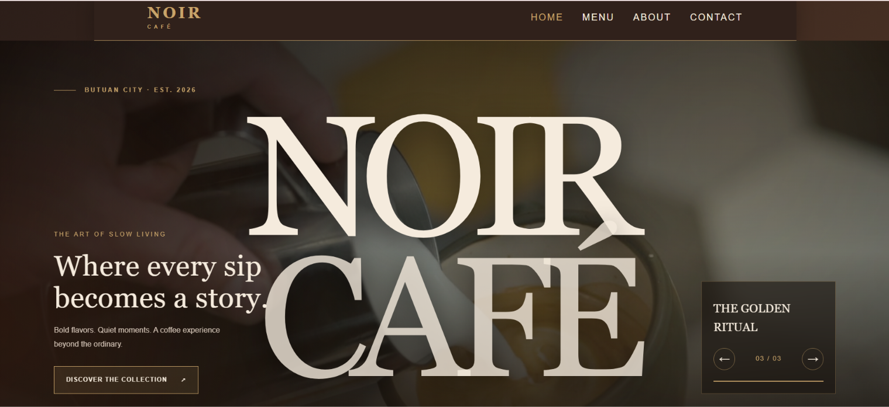
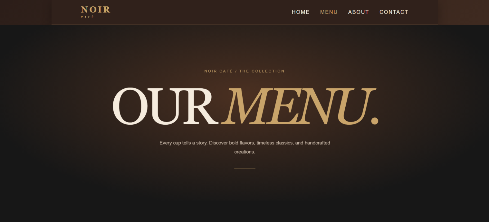
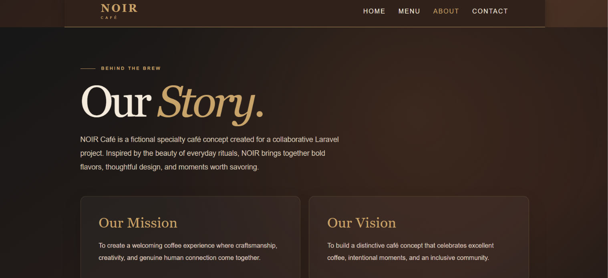
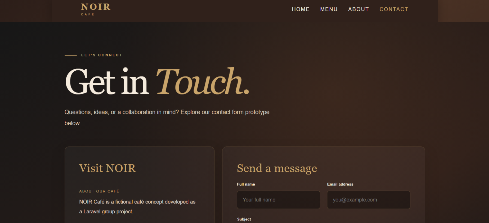

# NOIR Café
### Laravel Group Web Development Project

## Project Overview

NOIR Café is a café website developed using the Laravel framework. It presents the café's brand identity, coffee selections, background, and contact information through a clean, modern, and responsive web interface.

The website provides visitors with an organized way to explore the café, learn about its story, browse its menu, and contact the business.

## Group Information

- **Section:** GWLM1
- **Project:** Laravel Group Web Development
- **Repository:** Lara-Proj--GWLM1-Caina-Umayam-Calabroso

### Group Members

| Member | Assigned Responsibility |
|---|---|
| Ashley Shanne P. Caiña | Member 1 – Group Leader, Laravel Setup, Shared Layout, Home Page |
| Carl Umayam | Member 2 – About Page |
| Richelle Ann W. Calabroso | Member 3 – Contact Page |

## Website Pages and Features

### 1. Home Page
- Café introduction and hero section
- Coffee video carousel with Previous and Next controls
- Featured coffee collection
- Navigation to the other website pages

### 2. Menu Page
- Presentation of the café's coffee selections
- Menu information and product presentation

### 3. About Page
- Café background and story
- Mission and vision
- Group or team member presentation
- Read More / Read Less interaction

### 4. Contact Page
- Contact information
- Customer inquiry form
- Form validation and submission feedback

## Technologies Used

- **Laravel** – PHP web application framework
- **PHP** – Backend programming language
- **Blade** – Laravel templating engine
- **HTML5** – Website structure
- **CSS3** – Styling and responsive layout
- **JavaScript** – Interactive website features
- **Git and GitHub** – Version control and collaboration

## Project Structure

```text
app/
resources/
  views/
    layouts/
      app.blade.php
    home.blade.php
    menu.blade.php
    about.blade.php
    contact.blade.php
public/
  css/
  js/
  images/
  videos/
routes/
  web.php
```

## Installation and Setup

### Prerequisites

Make sure the following are installed:

- PHP 8.4 or a compatible version
- Composer
- Git
- A code editor such as Visual Studio Code

### Steps

1. Clone the repository:

```bash
git clone https://github.com/ashleycaina21-beep/Lara-Proj--GWLM1-Caina-Umayam-Calabroso.git
```

2. Navigate to the project directory:

```bash
cd Lara-Proj--GWLM1-Caina-Umayam-Calabroso
```

3. Install PHP dependencies:

```bash
composer install
```

4. Create the environment file:

```bash
cp .env.example .env
```

On Windows PowerShell, use:

```powershell
Copy-Item .env.example .env
```

5. Generate the application key:

```bash
php artisan key:generate
```

6. Run database migrations if required by the configured database:

```bash
php artisan migrate
```

7. Start the Laravel development server:

```bash
php artisan serve
```

8. Open the website:

```text
http://127.0.0.1:8000
```

## Screenshots

Add screenshots of the completed website pages below.

### Home Page


### Menu Page


### About Page


### Contact Page


## Branching and Collaboration

Each group member works on an assigned development branch. Changes are submitted through Pull Requests for review and merging into the main branch.

| Branch | Assigned Member |
|---|---|
| `dev-member1-Caina` | Ashley Shanne P. Caiña (Group Leader) |
| `dev-member2-Umayam` | Carl Umayam |
| `dev-member3-Calabroso` | Richelle Ann W. Calabroso |

**Note:** Members should not directly push unfinished work to the `main` branch.

---

**NOIR Café – Crafted with care.**
